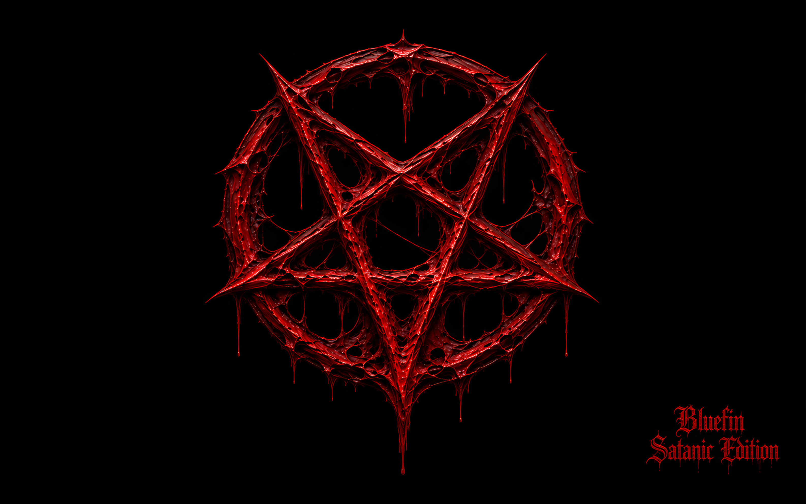

# Bluefin Satanic Edition

*A personal reboot of Ubuntu Satanic Edition, reborn on Bluefin Dakota.*

Bluefin Satanic Edition is a personal Dakota-based Linux desktop project with a dark GNOME default, red accent color, custom Satanic Edition wallpapers, and metal music. Dakota is Project Bluefin's GNOME OS and bootc-based system; this project builds its image from source with BuildStream.

The project takes inspiration from [Ubuntu Satanic Edition](https://ubuntusatanic.org/about/), an Ubuntu community remix that paired free software with dark artwork and metal music. This is an independent reboot of that idea, built on Dakota rather than Ubuntu. It is not an official continuation of the original project.

## Wallpapers and desktop

The build replaces the upstream wallpaper catalog with the project's own collection. The branded pentagram wallpaper shown here includes the words “Bluefin Satanic Edition.” Other choices include cathedral, goat, town, and village artwork. The Village entry pairs `village-day.png` and `village-night.png` for light and dark appearance. The monthly wallpaper service is also retained.



The desktop defaults to dark mode with the red GNOME accent. Tiling Shell is installed but disabled by default, Caffeine notifications are off, and Blur my Shell uses dynamic panel blur.

## Music

At first login, the image copies these tracks into the user's Music folder:

- **Infernal Descent**
- **Lord Beneath the Flame**

[Gapless](https://flathub.org/en/apps/com.github.neithern.g4music) is included as a Flatpak preinstall. It is installed during first boot when the system is online.

## Build the NVIDIA gaming image

The project's personal target is the NVIDIA gaming image. On a Linux host with `just` and Podman, run this from the repository root:

```bash
BUILD_GAMING=true just build nvidia
```

This builds and exports `dakota-nvidia-gaming:latest` to the local Podman image store. BuildStream runs in the project's configured container. See [CONTRIBUTING.md](CONTRIBUTING.md) for development guidance.

## Create an installer ISO

The GitHub Actions **Build Satanic Edition ISO** workflow can create a bootable installer ISO from a published NVIDIA gaming image:

1. Open the repository's **Actions** tab and select **Build Satanic Edition ISO**.
2. Choose **Run workflow** and provide the full tag of a published image, for example `ghcr.io/andrzejroskowicz/dakota-nvidia-gaming:stable`.
3. When the run completes, download the ISO from its workflow run artifacts.

The ISO workflow consumes an image already published to GHCR; it does not build or publish the image itself.

## AI and project disclaimer

**AI-use notice:** This project may include AI-generated artwork, music, and other materials, with human direction and editing. AI-generated content can contain errors or artifacts.

This is an independent personal project. It is not affiliated with Canonical, Ubuntu, the original Ubuntu Satanic Edition project, or Project Bluefin. Product names and trademarks belong to their respective owners.
